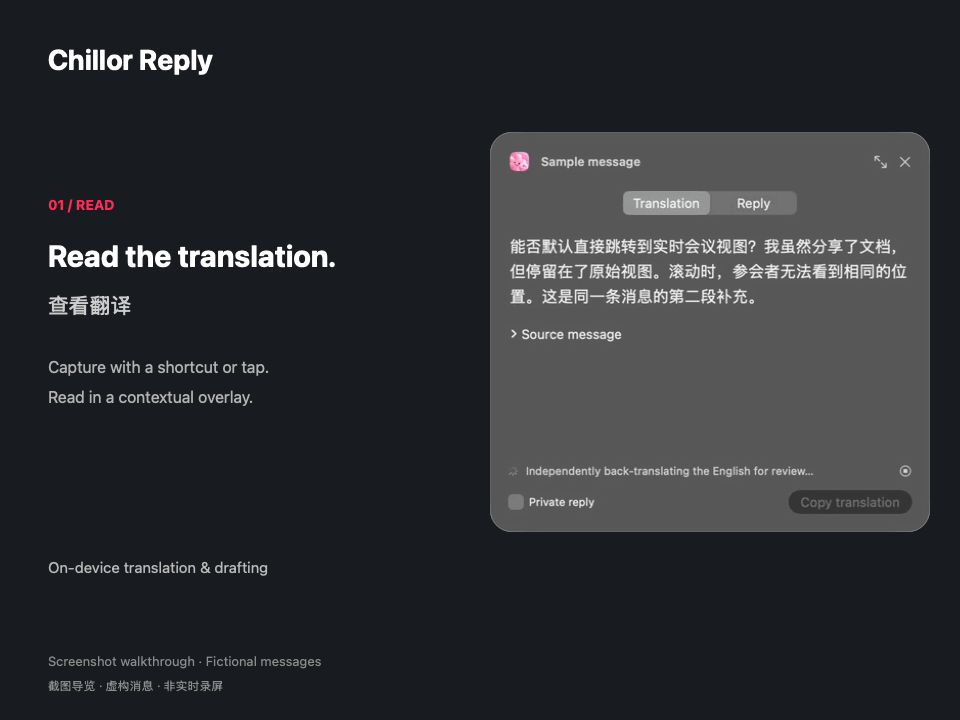
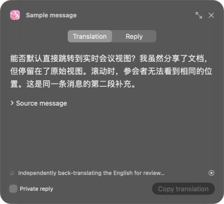
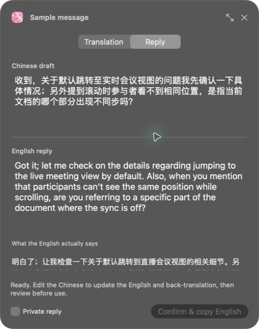

# Chillor Reply

A native macOS app for translating selected messages and drafting bilingual replies locally. Part of the Chillor app family.

[中文说明](README.zh-CN.md) · [Architecture](docs/ARCHITECTURE.md) · [Privacy](docs/PRIVACY.md) · [Contributing](CONTRIBUTING.md)

## See it in action

[](https://github.com/cellier/Chillor-Reply/raw/refs/heads/main/docs/media/walkthrough.mp4)

[Watch / download the MP4 walkthrough](https://github.com/cellier/Chillor-Reply/raw/refs/heads/main/docs/media/walkthrough.mp4)

*An approximately 12-second screenshot walkthrough using fictional messages. These are actual development-build screenshots, not a real-time screen recording or a latency benchmark. The translation screenshot shows generation in progress.*

| Read the translation | Review and edit the reply |
| --- | --- |
|  |  |

## What it does

- Capture content near your pointer with a keyboard shortcut, or a double tap on supported MacBooks.
- Show translations and replies in a contextual dark glass overlay.
- Translate incoming text, suggest a Chinese draft, generate English, and independently translate that English back into Chinese for review.
- Refine replies through follow-up instructions. Copy or fill a reply only after confirmation; the app never sends messages.
- Optionally retain local text history, vocabulary and reply preferences. UI language follows the system, with English and simplified/traditional Chinese resources.

## Status and requirements

Version 0.10.6 is an experimental source build for Apple Silicon Macs. macOS 14+ is the deployment target; building the Liquid Glass code requires Xcode 26 or newer and its macOS SDK. Glass controls fall back on older supported systems.

Local inference uses **Ollama 0.33.3 + Qwen 3.8 27B (Q4_K_M)**. The model download is approximately **17.7 GB** and is not included in this repository. This configuration has been tested on a 48 GB Mac; a minimum supported RAM configuration has not been established. Model execution needs additional memory beyond the model file size.

Tap detection uses undocumented motion-sensor interfaces and is experimental. Availability and recognition vary by device, placement and macOS version; shortcuts remain available when sensors are unavailable. Visible context is not a complete conversation history. Translation and reply suggestions require review.

## Build and run

Install Xcode 26 or newer, select its developer directory and complete Xcode's first-run setup. From this repository:

```sh
./build.sh "$PWD/build"
open "build/Chillor Reply.app"
```

The script downloads the pinned official Ollama runtime, compiles Swift directly, signs the app locally and runs the deterministic test suites. No package manager is required. To reuse an already extracted official runtime:

```sh
REPLYLENS_RUNTIME_DIR=/path/to/extracted/ollama ./build.sh "$PWD/build"
```

The default ad-hoc build is not notarized. Rebuilding can invalidate macOS permissions. Grant Accessibility and Screen Recording through System Settings as needed, then quit and reopen the app. Download the model through the app's first-run/settings flow; downloads can be resumed. Runtime/model downloads need internet, while inference uses the local loopback service.

Point at a message and press **Control–Option–Space** to capture it. Review and edit the result before using the explicit copy/fill action. Some editors cannot accept Accessibility-based filling; copy/paste is the fallback.

## Tests

The build runs OCR/message grouping, memory, reply-state/tap and localization tests using synthetic fixtures. It does not need model weights for these suites.

```sh
APP="build/Chillor Reply.app/Contents/MacOS/ChillorReply"
"$APP" --self-test
"$APP" --memory-test
"$APP" --automation-test
# Requires the downloaded local model; uses fictional messages:
"$APP" --model-test
# Requires supported live motion sensors:
"$APP" --tap-health
```

`--tap-replay /path/to/recordings` is an optional developer diagnostic. Personal sensor recordings, screenshots, chat captures, database files, model weights and development logs are deliberately excluded from the public source. Synthetic tests do not establish real-world gesture accuracy.

## Project layout

The Swift sources are at the repository root. See [architecture and data flow](docs/ARCHITECTURE.md) for module responsibilities. `Resources/` contains the app icon and localization resources. `build.sh` is the build/test entry point.

The historical `ReplyLens` names in bundle IDs, filenames and data directories are retained for compatibility. Do not change these identifiers casually: existing permissions, model downloads and user data depend on them.

## License

Project source is available under the [MIT License](LICENSE). External runtime/model terms are described in [THIRD_PARTY_NOTICES.md](THIRD_PARTY_NOTICES.md).

### SDK troubleshooting

Validated locally with Swift 6.4 and the macOS 26.5 SDK. A Command Line Tools installation whose default SDK is macOS 27 may fail with `SwiftUIMacros.StateMacro` missing. Select a complete Xcode toolchain, or explicitly use an installed macOS 26.5 SDK:

```sh
SDKROOT=/Library/Developer/CommandLineTools/SDKs/MacOSX26.5.sdk ./build.sh "$PWD/build"
```

Use this path only if that SDK is installed.
