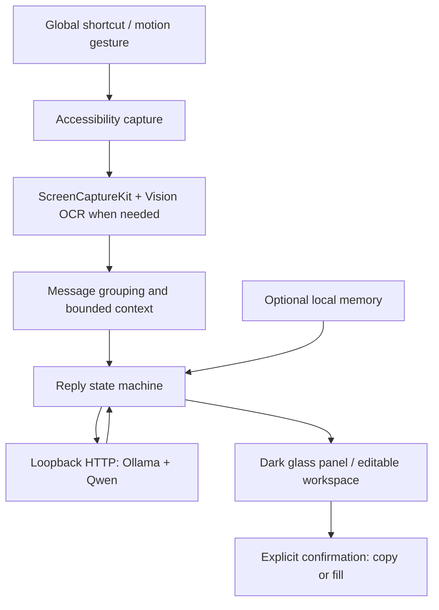

# Architecture

Chillor Reply is a native SwiftUI/AppKit application with a bundled local inference subprocess. It has no cloud application backend, browser renderer or autonomous send loop.

| Module | Responsibility |
| --- | --- |
| `main.swift` | App lifecycle, global shortcuts, permissions, Accessibility, screenshot/OCR capture |
| `MessageDetection.swift` | Message boundaries, paragraphs, source cleanup and bounded context |
| `LocalReply.swift` | Local runtime, loopback transport, prompts, streaming, reply state, safe text filling |
| `ResultOverlay.swift` | Non-activating native panel, placement, dismissal and result presentation |
| `ChillorUI.swift` | Workspace, source inspector, settings and native controls |
| `TapTrigger.swift` | IOKit HID sensors, hardware timestamps, input-activity veto and saved preferences |
| `TapDetection.swift` | Pure timestamp-driven impulse and gesture detection |
| `MemoryStore.swift` | SQLite persistence, encrypted records, history, vocabulary and preference retrieval |
| `MemoryView.swift` | User controls for memory history and preferences |
| `Localization.swift` | System-language routing and localized runtime messages |

The reply pipeline separates reading translation, suggested Chinese draft, English generation and independent back-translation. Back-translation receives the English output only. Debouncing, task cancellation and request identifiers prevent obsolete responses from overwriting new edits. Each stage uses its own sampling settings.

Ollama listens at `127.0.0.1:11439`; requests reject redirects and proxies, and the runtime starts with `OLLAMA_NO_CLOUD=1`. The model is `qwen3.8:27b`, with a 6144-token configured context. No remote model fallback is provided.

Tap recognition runs on a serial sensor queue rather than the UI thread. It combines acceleration impulses, resting motion and gyro checks, cadence, a confirmation window, cooldown, and keyboard/click activity vetoes. It reads input event ages, not typed characters. Sensor interfaces are undocumented; support must be tested on actual devices.

Memory is opt-in. Confirmed copy/fill events are evidence of adoption, not proof that a message was sent. Retrieval is bounded to relevant terms and preferences; raw past conversations are not automatically promoted into factual context. Deleting evidence also removes unsupported derived preferences.

Current engineering limits include ad-hoc signing, no notarized distribution/update channel, application-specific Accessibility compatibility, heuristic message boundaries and unmeasured cross-device tap accuracy.
